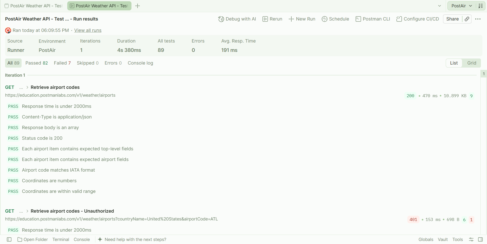
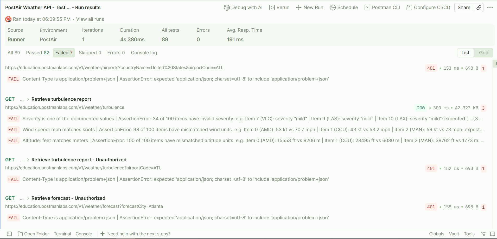
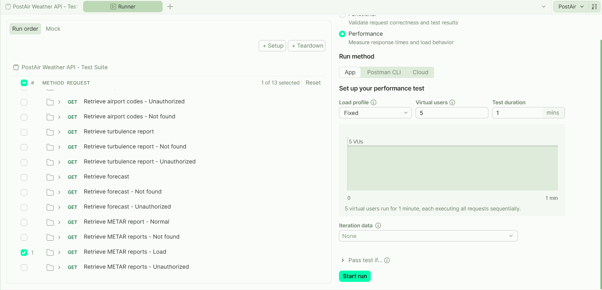
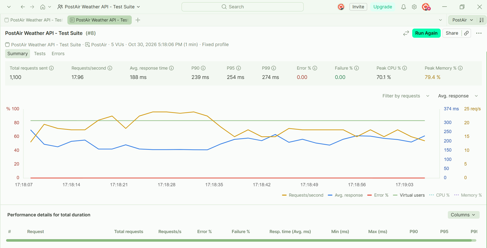

# PostAir Weather API: API Testing

Automated API tests for the PostAir Weather API v1 (Postman Education), built with Postman and run with the Collection Runner.
The collection is a fork of Postman’s PostAir learning collection.
I added the data validation tests for the Turbulence endpoint (severity values, wind speed and altitude unit consistency), which were not part of the course, and they found 3 of the 4 defects below.

**Result:** 89 tests, 82 passed, 7 failed. The 7 failures come from 4 defects (see Findings). A separate load test on the METAR endpoint showed no performance issues.

## Endpoints tested

| Endpoint | Path |
|---|---|
| Airport codes | `GET /v1/weather/airports` |
| Turbulence report | `GET /v1/weather/turbulence` |
| Forecast | `GET /v1/weather/forecast` |
| METAR reports | `GET /v1/weather/metars` |

## What is tested

- **Status codes:** 200, 401, 404
- **Response headers:** Content-Type
- **Structure:** response is an array and each item has the expected top-level fields
- **Data validation:** IATA code format, coordinate type and range, severity values, wind speed and altitude unit consistency
- **Error responses:** error body follows the `problemDetail` schema, detail text is descriptive, no internal details leaked
- **Performance:** response time under 2000 ms per request, plus a load test (see Performance testing)

## Findings

| ID | Defect | Endpoints | Failing test | Bug severity | Evidence |
|---|---|---|---|---|---|
| BUG-01 | 401 responses return `application/json` instead of the documented `application/problem+json` | All 4 | Content-Type is application/problem+json | Medium | [ticket](docs/bug-reports/bug-01.pdf) |
| BUG-02 | Severity `"mild"` is not in the spec enum (light, moderate, severe, extreme); 34 of 100 items | Turbulence | Severity is one of the documented values | Medium | [ticket](docs/bug-reports/bug-02.pdf) |
| BUG-03 | `windSpeed.mph` is inconsistent with `windSpeed.knots`; 98 of 100 items | Turbulence | Wind speed: mph matches knots | High | [ticket](docs/bug-reports/bug-03.pdf) |
| BUG-04 | `altitude.meters` is inconsistent with `altitude.feet`; 100 of 100 items | Turbulence | Altitude: feet matches meters | High | [ticket](docs/bug-reports/bug-04.pdf) |

The defects were filed as tickets in Jira. The PDFs in `docs/bug-reports` show each full report.

## Run results

## Performance testing

Load test run with Postman's Performance mode in the Collection Runner, using a dedicated request, `Retrieve METAR reports - Load`.

| Setting | Value |
|---|---|
| Endpoint | `GET /v1/weather/metars?airportCode=ATL` |
| Load profile | Fixed, 5 virtual users |
| Duration | 1 minute |

| Result | Value |
|---|---|
| Total requests | 1,100 |
| Requests per second | 17.96 |
| Average response time | 188 ms |
| P90 / P95 / P99 | 239 ms / 254 ms / 274 ms |
| Error rate / failure rate | 0% / 0% |

The request's checks were: status code 200, response time under 800 ms, and response size under 2 KB. There is also a soft warning in the console above 600 ms. All checks passed, so no defects were filed for performance. This is a small load (5 users for 1 minute), so the result only covers that level.

## Repository contents

- `postman/collections/`: the test collection, in Postman's file format. Scripts are stored inside the request files as text, so they look like quoted strings.
- `postman/environments/`: the `PostAir` environment (`baseUrl` only).
- `postman/specs/`: the API specification used as the reference for expected results.
- `docs/`: PDFs of the bug tickets, and screenshots of run results and load test.

## Running the tests

1. Clone the repo and open the folder in the Postman desktop app (**Local Files**, then **Open Folder**).
2. Select the `PostAir` environment and add your own API key (as a Postman Vault secret or an environment variable).
3. Open the collection, click **Run**, and start the run in the Collection Runner.

The 7 failing tests are expected, because they report the defects above. The Unauthorized requests use an intentionally invalid API key to trigger 401 responses.

## Notes

- This is a practice project on a public learning API. The defects are documented, and no fixes are expected.
- The specification belongs to Postman's PostAir learning material and is included as the reference for the expected results.
- Tools: Postman (test scripts, Collection Runner, performance testing) and Jira (defect tracking).